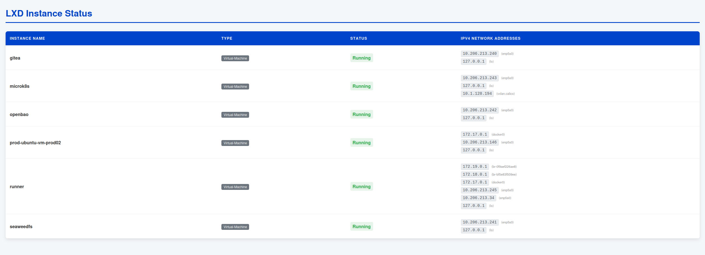

#                      Go app deployment
---
# Go app to monitor lxd VMs via webui



---

## Table of Contents

- [Summary](#summary)
- [Folder Structure](#folder-structure)
- [Prerequisites](#prerequisites)
- [Quick Steps to Deploy](#quick-steps-to-deploy)
- [Access Links](#access-links)
- [Architecture](#architecture)
  - [Go app deploymemnt architecture](#go-app-deployment-architecture---microk8s---terraform---gha-runner---openbao-vault)
  - [GHA Workflow & Secrets](#gha-workflow--secrets)
  - [Go App Internal Workflow & Secrets](#go-app-internal-workflow--secrets)
- [Workflow Details](#workflow-details)
- [Go App Details](#go-app-details)
- [Roadmap](#roadmap)

---

## Summary

A lightweight Go web application that displays the live status of LXD instances (VMs and containers) in your homelab. It authenticates with OpenBao via AppRole to securely retrieve LXD TLS credentials at runtime, queries the LXD API, and renders results in a clean HTML dashboard.

Deployed on MicroK8s via Helm across three isolated environments — **dev**, **staging**, and **live** — using a Gitea Actions CI/CD pipeline with sequential environment promotion.

---

## Folder Structure

```
.
├── app/
│   ├── main.go               # HTTP server, LXD + OpenBao client logic
│   ├── index.html            # Go HTML template for the dashboard
│   ├── dockerfile            # Multi-stage Docker build
│   ├── go.mod
│   └── go.sum
├── helm-chart/
│   ├── Chart.yaml
│   ├── values.yaml           # Base defaults
│   ├── values-dev.yaml       # dev environment overrides
│   ├── values-staging.yaml   # staging environment overrides
│   ├── values-live.yaml      # live environment overrides
│   └── templates/
│       ├── deployment.yaml
│       ├── service.yaml
│       └── ingress.yaml
├── .gitea/
│   └── workflows/
│       ├── pr-pipeline.yml   # PR flow: build → dev → staging
│       └── push-pipeline.yml # Merge flow: build → live
├── setup/
│   ├── openbao-setup.sh      # One-time OpenBao policy + secret setup
│   └── microk8s-setup.sh     # One-time namespace + K8s secret setup
├── .gitignore
└── README.md
```
---
## Architecture

### Infrastructure Archtecture - GHA - kubernetes - openbao (vault)

```
Developer / GitHub Actions Runner
----main commands----
docker build
docker push
helm install/upgrade
---------------------

Gitea / Developer
+-----------------------------------+
| Source Code + Helm Chart Folder   |
| Chart.yaml, values.yaml, templates|
+-----------------------------------+
        │
        |
+------------------+
|Runner / Developer├──────────────────────────────────────────────────────► docker build
+------------------+                                                      │
        │                                                                 ▼
        │                                                        +------------------+
        │                                                        | Docker Image     |
        │                                                        | (tagged version) |
        │                                                        +------------------+
        │                                                                 │
        │                                                                 ▼
        │                                                             docker push
        │                                                                 │
        │                                                                 ▼
        │                                                       +------------------+
        │                                                       | MicroK8s Registry|
        │                                                       | Stores container |
        │                                                       | images           |
        │                                                       +------------------+
        │
        └───────────────► helm install/upgrade
                              │
                              ▼
                      +----------------------+
                      | Helm Metadata        |
                      | - Release name       |
                      | - Values used        |
                      | - Chart version      |
                      | - History snapshot   |
                      +----------------------+
                              │
                              ▼
                      +----------------------+
                      | Kubernetes Objects   |
                      | - Deployment         |
                      | - Service            |
                      | - Ingress            |
                      | - ConfigMaps/Secrets |
                      +----------------------+
                              │
                              ▼
                      +----------------------+
                      | Pods (runtime)       |
                      | - Pull images from   |
                      |   MicroK8s registry  |
                      | - Ephemeral, auto-   |
                      |   recreated by K8s   |
                      +----------------------+

```
### Secrets Architecture - Go app - kubernetes - openbao (vault)

```
K8s Secret (openbao-creds)         ← created manually via kubectl  
├── VAULT\_ADDR                         in each namespace (dev/staging/live)  
├── VAULT\_ROLE\_ID  
└── VAULT\_SECRET\_ID  
         │  
         │
      Helm Charts  injected via envFrom in values.yaml ---injected---> deployment.yaml  
         │  
         ▼  
      Go App (main.go)  
      getSecrets() function  
         │  
         │  AppRole login on every HTTP request  
         ▼  
      OpenBao  
         │  
         └── homelab/data/lxd  
                  │  
                  ├── client\_cert    → LXD TLS auth  
                  └── client\_key     → LXD TLS auth  
                           │  
                           ▼  
                        LXD API  
                  https://10.0.0.162:8443  
                           │  
                           ▼  
                    Instance list  
                    (name, type, status, IPs)  
                           │  
                           ▼  
                      index.html  
                      rendered to browser

```

### Secrets architecture - GHA - kubernetes - openbao (vault)

Correct. The three Gitea org secrets are for the runner’s bootstrap credentials only:
```
Gitea org secrets (VAULT_ADDR, VAULT_ROLE_ID, VAULT_SECRET_ID)
        │  AppRole login
        ▼
OpenBao  →  homelab/data/microk8s   (kubeconfig)
         →  homelab/data/registry   (registry address)  ← new (maybe later. still hardcoded in GHA workflow 10.206.213.243:3200)
```

```
┌──────────────────────────────────────────────────┐
│              Gitea Org Secrets                   │
│  ├── VAULT_ADDR                                  │
│  ├── VAULT_ROLE_ID      → same for ALL workflows │
│  └── VAULT_SECRET_ID                             │
└──────────────────────────┬───────────────────────┘
                           │
                           ▼
┌──────────────────────────────────────────────────┐
│                   OpenBao                        │
│               AppRole login                      │
└──────────────────────────┬───────────────────────┘
                           │
                           ▼
┌──────────────────────────────────────────────────┐
│         homelab/data/microk8s                    │
│              kubeconfig                          │
│   (server: https://10.206.213.243:16443)         │
└──────────────────────────┬───────────────────────┘
                           │
                           ▼
┌──────────────────────────────────────────────────┐
│           GHA Runner (LXD VM)                    │
│     export KUBECONFIG=/tmp/kubeconfig            │
└──────────┬───────────────┬───────────────┬───────┘
           │               │               │
           ▼               ▼               ▼
    ┌────────────┐  ┌────────────┐  ┌────────────┐
    │helm deploy │  │helm deploy │  │helm deploy │
    │   dev      │  │  staging   │  │   live     │
    └────────────┘  └────────────┘  └────────────┘

PR Pipeline:   build-pr → deploy-dev-pr → deploy-staging-pr
Push Pipeline: build    → deploy-live
```
---

## Prerequisites

| Tool | Purpose |
|---|---|
| Docker | Build and push the image |
| MicroK8s | Local Kubernetes cluster |
| Helm | Deploy the application |
| OpenBao | Secrets backend (AppRole auth) |
| LXD | Target API to query |
| Gitea | Source control and CI/CD runner |

MicroK8s add-ons required:
```bash
microk8s enable dns registry ingress helm3
```
### One-time infrastructure setup

**MicroK8s** — create namespaces and inject OpenBao credentials as K8s secrets:
```bash
microk8s kubectl create namespace dev
microk8s kubectl create namespace staging
microk8s kubectl create namespace live

for NS in dev staging live; do
  microk8s kubectl create secret generic openbao-creds \
    --from-literal=VAULT_ADDR=https://<openbao-ip>:8200 \
    --from-literal=VAULT_ROLE_ID=<role-id> \
    --from-literal=VAULT_SECRET_ID=<secret-id> \
    --namespace=$NS \
    --dry-run=client -o yaml | microk8s kubectl apply -f -
done
```

**Add ingress hosts** to `/etc/hosts` on the machine you browse from:
```bash
echo "<microk8s-node-ip>  dev.local staging.local live.local" | sudo tee -a /etc/hosts
```

**Gitea org secrets** — add at org level so all repos can use them:
```
Settings → Secrets → VAULT_ADDR
                   → VAULT_ROLE_ID
                   → VAULT_SECRET_ID
```
---

## Quick Steps to Deploy

### 1. Clone and create a branch

```bash
git clone https://gitea.local/Infra/go-lxd-vm-dashboard-gha.git
cd go-lxd-vm-dashboard-gha
git checkout -b feature/my-change
```

### 2. Make changes, push and raise a PR

```bash
git add .
git commit -m "feat: my change"
git push origin feature/my-change
```

Open a PR in Gitea: `feature/my-change → main`

This triggers **pr-pipeline.yml** automatically — build, deploy to dev, deploy to staging.

### 3. Merge to main

Once PR is reviewed and merged into `main`, this triggers **push-pipeline.yml** automatically — build and deploy to live.

---

## Access Links

| Pipeline | Job | Status | URL |
|---|---|---|---|
| PR Pipeline | build-pr | ✅ | — |
| PR Pipeline | deploy-dev-pr | ✅ | http://dev.local |
| PR Pipeline | deploy-staging-pr | ✅ | http://staging.local |
| Push Pipeline | build | ✅ | — |
| Push Pipeline | deploy-live | ✅ | http://live.local |

### Workflow Details

**PR Pipeline** (`.gitea/workflows/pr-pipeline.yml`):

```
build-pr          → builds image tagged pr-<run_number>
                    pushes to 10.206.213.243:32000
                    runs automatically

deploy-dev-pr     → needs: build-pr
                    fetches kubeconfig from OpenBao
                    helm upgrade --install --namespace dev
                    --values helm-chart/values-dev.yaml
                    --set image.tag=pr-<run_number>
                    verifies rollout

deploy-staging-pr → needs: deploy-dev-pr
                    fetches kubeconfig from OpenBao
                    helm upgrade --install --namespace staging
                    --values helm-chart/values-staging.yaml
                    --set image.tag=pr-<run_number>
                    verifies rollout
```

**Push Pipeline** (`.gitea/workflows/push-pipeline.yml`):

```
build             → builds image tagged latest
                    pushes to 10.206.213.243:32000
                    runs automatically

deploy-live       → needs: build
                    fetches kubeconfig from OpenBao
                    helm upgrade --install --namespace live
                    --values helm-chart/values-live.yaml
                    --set image.tag=latest
                    verifies rollout
```

---

## Go App Details

**Language:** Go

**Entry point:** `app/main.go`

**How it works:**

Every HTTP request to `/` triggers this sequence:

1. **`getSecrets()`** — authenticates to OpenBao using AppRole credentials from the `openbao-creds` K8s secret. Reads `homelab/data/lxd` to retrieve the LXD TLS client certificate and key.

2. **`lxd.ConnectLXD()`** — connects to the LXD API at the address set in `values.yaml` (`lxd.address`), using the TLS cert/key from OpenBao. TLS verification is skipped (`InsecureSkipVerify: true`).

3. **`client.GetInstancesFull()`** — queries all instances (VMs and containers) in the `default` LXD project.

4. **`renderTemplate()`** — passes instance data to `index.html` and renders the HTML dashboard.

**Environment variables injected at runtime:**

| Variable | Source | Purpose |
|---|---|---|
| `VAULT_ADDR` | K8s Secret `openbao-creds` | OpenBao server address |
| `VAULT_ROLE_ID` | K8s Secret `openbao-creds` | AppRole Role ID |
| `VAULT_SECRET_ID` | K8s Secret `openbao-creds` | AppRole Secret ID |
| `VAULT_SKIP_VERIFY` | `deployment.yaml` hardcoded | Skip OpenBao TLS verify |
| `LXD_ADDR` | `values.yaml` via `deployment.yaml` | LXD API endpoint |
| `PORT` | optional | HTTP listen port (default: 8080) |

**Docker build:**

Multi-stage build — Go binary compiled in `golang:1.26.2-alpine`, copied into `alpine:latest` final image. Only the binary and `index.html` are included. No credentials baked in.

```bash
docker build -t 10.206.213.243:32000/go-lxd-vm-dashboard:latest ./app
docker push 10.206.213.243:32000/go-lxd-vm-dashboard:latest
```

**Helm chart:**

| File | Purpose |
|---|---|
| `values.yaml` | Base defaults — image, service, LXD address, ingress |
| `values-dev.yaml` | Overrides ingress host to `dev.local` |
| `values-staging.yaml` | Overrides ingress host to `staging.local` |
| `values-live.yaml` | Overrides ingress host to `live.local` |
| `deployment.yaml` | Pod spec — env injected from secret and values |
| `service.yaml` | ClusterIP service, port 80 → 8080 |
| `ingress.yaml` | NGINX ingress, public class |

---

## Roadmap

- [ ] Switch `workflow_dispatch` to real `pull_request` / `push` triggers
- [ ] Gitea environment approval gates (dev / staging / live)
- [ ] Multi-project LXD support
- [ ] Memory / CPU metrics from LXD state API
- [ ] Dark mode for the dashboard
